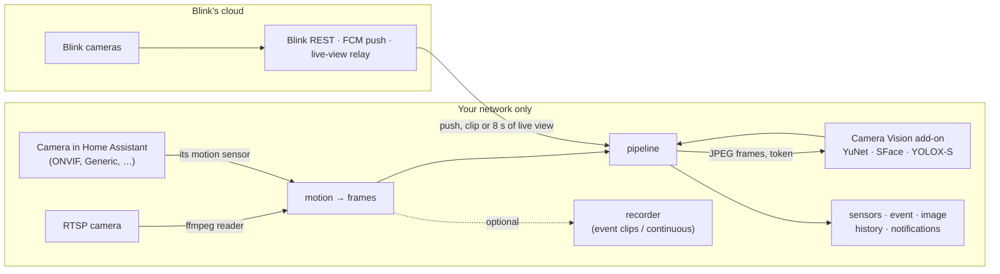

# Local Camera Vision

*Formerly Blink Instant Events. A Home Assistant integration (HACS); same domain, entities and actions as before.*

Cameras in Home Assistant with smart detection that runs on your own hardware: who is at the door
(people you taught it, unknown faces, maybe-someone), people, vehicles and pets, as sensors and
events your automations and phone notifications can use.

Two kinds of cameras, independent of each other:

- **Local cameras** (RTSP, ONVIF, any camera already in Home Assistant): no account, no
  subscription, no cloud. Video is read on your network and analyzed on your network.
- **Blink cameras**: instant motion and doorbell events over Blink's own push channel, plus
  arm/disarm, snapshots, clips, live view with two-way talk and camera controls. These depend on
  Blink's cloud, as the Blink app does.

> **Unofficial.** Not affiliated with Blink, Amazon, Google or Home Assistant. The Blink half relies on
> reverse-engineered behaviour of the Blink app and can break whenever Blink changes it.

## How it fits together



The pipeline never knows where frames came from. The code: `providers/blink`, `providers/rtsp`,
`providers/camera` (where pictures and motion come from), `ai/` (the shared pipeline, entities, actions)
and `blink_vision/` (the add-on that does the looking).

## What needs the internet

| Feature | Local cameras | Blink cameras |
| --- | --- | --- |
| Motion events | local (stream or the camera's own sensor) | Blink cloud + Google FCM |
| Live view | local (Home Assistant's stream) | Blink cloud relay (camera wakes, then streams) |
| Snapshots | local | Blink cloud (wakes the camera) |
| Recordings | local, to Home Assistant's media folder | Blink's clips: cloud or Sync Module USB, **both fetched through Blink's cloud** |
| Smart detection (faces, people, vehicles, pets) | local | local analysis of frames fetched from Blink's cloud |
| Face database | local (add-on data, in your backups) | same |
| Arm/disarm, camera settings | — | Blink cloud |

Local cameras never contact Blink, Amazon, Google or any other service; the tests prove it (below).
Blink cameras do not offer a local RTSP or ONVIF stream; see
[docs/blink-local-feasibility.md](docs/blink-local-feasibility.md).

## Requirements

- Home Assistant 2026.10 or newer (its built-in `ffmpeg` reads streams and clips)
- For smart detection: the **Camera Vision** add-on (Home Assistant OS/Supervised) or its Docker image
- For Blink cameras: a Blink account (email + password + the PIN Blink sends); one per Home Assistant

## Install

1. HACS → ⋮ → **Custom repositories** → add this repository's URL, category **Integration**.
2. Download **Local Camera Vision**, restart Home Assistant.
3. For smart detection: Settings › Add-ons › Add-on store › ⋮ › Repositories › add
   `https://github.com/rohanjariwala03/ha-local-camera-vision`, install **Camera Vision**, start it.
   It announces itself (with its token) and Home Assistant offers to set it up under
   **Settings → Devices & services → Discovered**.
4. **Settings → Devices & services → Add integration → Local Camera Vision**, then pick what to add.
   Add as many local cameras as you like.

### An RTSP camera (no account anywhere)

Choose **RTSP camera**: a name, the stream address (e.g. `rtsp://192.168.1.20:554/stream2`), and its
login if it has one. One frame is read to check the address and login before it is saved; the login is
stored apart from the address and never logged.

Use the camera's **sub-stream** if it has one (often `/stream2`, `…/102`, `subtype=1`): detection needs
little resolution and a Raspberry Pi decodes it far faster. **Configure** sets how it is read
(frames per second, frame width, *decode keyframes only* for the lowest CPU), motion sensitivity,
frames per detection, the cooldown between detections, and recording.

### An ONVIF camera

Add it with Home Assistant's own **ONVIF** integration first: it discovers ONVIF cameras on your network,
reads the device information and stream profiles, picks the RTSP address, and turns the camera's motion
events into a binary sensor (where the camera supports ONVIF events; not all do). Then add **A camera
already in Home Assistant** here, and pick that camera and its motion sensor. Generic Camera, Reolink,
UniFi Protect and other camera integrations work the same way.

If an ONVIF camera has no motion events, add its RTSP address as an **RTSP camera** instead: motion is
then measured on the stream itself.

### A Blink account

Choose **Blink account (cloud)**, enter your Blink email and password, then the PIN Blink sends. The
password is used once and not stored; if Blink later revokes the session, Home Assistant asks you to
sign in again. For instant events: **Configure → Sign in for instant events**. Blink pushes only to its
Android app, so this signs in once more, as that app. Use Blink's own page, on a computer rather than a
phone with the Blink app. When the sign-in finishes, paste the address it ends on
(`https://applinks.blink.com/signin/callback?…`) into the form. Until you do, a repair reminds you, and
motion only shows up from polling.

## Entities

Every camera, local or Blink (`<camera>` = its name, e.g. `front_door`):

| Entity | Description |
| --- | --- |
| `binary_sensor.<camera>_person` | On for 60 s after a detection with a person in it. |
| `binary_sensor.<camera>_known_person` | Someone you taught it was recognized (confirmed in 2 frames, or 1 strong match). |
| `binary_sensor.<camera>_unknown_person` | An unknown face, or a person whose face couldn't be matched (from behind counts). |
| `binary_sensor.<camera>_uncertain_identity` | A face that only possibly matches someone; never counted as known. |
| `binary_sensor.<camera>_vehicle`, `binary_sensor.<camera>_pet` | Cars, trucks, buses, motorcycles, bicycles; cats and dogs. |
| `sensor.<camera>_last_detection` | "Rohan and a vehicle", with `people`, `uncertain`, `unknown_faces`, `labels`, `identity`, `matches` (similarity per name), `confidence`, `known_only`. |
| `image.<camera>_last_detection` | The best frame of that detection, boxes drawn. |

Local cameras also have `event.<camera>_event` (`motion`, `detection`, `recording`) and, for RTSP,
`camera.<camera>` (live view through Home Assistant), `binary_sensor.<camera>_motion` and
`binary_sensor.<camera>_stream` (connected; `last_error`, `restarts`, `dropped_frames`).

Blink cameras also have:

| Entity | Description |
| --- | --- |
| `event.<camera>_blink_event` | `motion`, `doorbell_press` (doorbells), `detection`, or Blink's raw type (e.g. `camera_offline`). |
| `binary_sensor.<camera>_motion` | On for 30 s after each motion push. `last_record` attribute. |
| `camera.<camera>` | Latest Blink snapshot. |
| `camera.<camera>_live_view` | Live-view details for apps (the stream is the HTTP API). |
| `button.<camera>_refresh_snapshot` | Take a new snapshot (wakes the camera). |
| `switch.<camera>_motion_detection` | The camera's motion detection. |
| `binary_sensor.<camera>_battery`, `sensor.<camera>_battery_voltage`, `sensor.<camera>_temperature`, `sensor.<camera>_wifi_signal` | Battery and health, where the model reports them. |

Per Sync Module network: `alarm_control_panel.blink_<network>` and `binary_sensor.blink_<network>_connection`.
Account: `sensor.blink_instant_events_last_blink_refresh` and `binary_sensor.blink_instant_events_push_connection`.
The automation editor offers device triggers **Motion detected**, **Doorbell pressed** and **Detection**.

Every `detection` event carries `summary`, `people`, `uncertain`, `unknown_faces`, `labels`, `identity`
(`known`/`uncertain`/`unknown`/none), `matches`, `confidence`, `known_only`, `provider`, `source`
(`local`/`cloud`), `timestamp`, and `image`: a signed link to the annotated frame, valid 24 hours, for
notifications.

## Actions

| Action | What it does |
| --- | --- |
| `blink_instant_events.enroll_face` | Admins only. Teach a face from a camera's current picture (`camera`) or a photo file (`file`, inside `allowlist_external_dirs`, e.g. `/media`). One face, close (≥ 80 px), sharp and facing the camera; a face that already matches someone else is refused unless `force: true`; the same photo twice is not stored twice. |
| `blink_instant_events.delete_face` | Admins only. Forget every photo of a person. |
| `blink_instant_events.process_snapshot` | Analyze any camera's picture now and get the detection back (`response_variable`). |
| `blink_instant_events.show_on_tv` | Blink: play a camera's live view on a Cast TV for `duration` seconds. |

Unknown faces are never learned by themselves. Several photos from different angles and lighting help.

## Automations

A notification with the picture when an unknown person is at the door, from any camera:

```yaml
triggers:
  - trigger: state
    entity_id: binary_sensor.porch_unknown_person
    to: "on"
actions:
  - action: notify.mobile_app_phone
    data:
      title: Unknown person at the porch
      message: "{{ state_attr('sensor.porch_last_detection', 'summary') }}"
      data:
        image: "{{ state_attr('image.porch_last_detection', 'entity_picture') }}"
```

Quiet when only people you know were seen (recognition is a likelihood, so keep it for convenience,
not for unlocking doors):

```yaml
triggers:
  - trigger: state
    entity_id: event.porch_event
    not_from: unavailable
conditions:
  - "{{ trigger.to_state.attributes.event_type == 'detection' }}"
  - "{{ not trigger.to_state.attributes.known_only }}"
  - "{{ 'person' in trigger.to_state.attributes.labels }}"
actions:
  - action: notify.mobile_app_phone
    data:
      message: "{{ trigger.to_state.attributes.summary }}"
      data:
        image: "{{ trigger.to_state.attributes.image }}"
```

Blink doorbell on the TV:

```yaml
triggers:
  - trigger: state
    entity_id: event.front_door_blink_event
    not_from: unavailable
conditions:
  - condition: state
    entity_id: event.front_door_blink_event
    attribute: event_type
    state: doorbell_press
actions:
  - action: blink_instant_events.show_on_tv
    data:
      camera: camera.front_door
      media_player: media_player.living_room_tv
```

## Recording (RTSP cameras)

Off by default. **Event clips** keeps a rolling buffer of 2-second segments in Home Assistant's cache and,
`post` seconds after motion starts, joins the segments from `pre` seconds before it into one MP4 under
the media folder (Media › My media › `blink_instant_events/<camera>/<date>/`); the `recording` event names
it. **Continuous** keeps one-minute segments there instead. Video is copied, never re-encoded, so it costs
disk, not CPU; audio is not recorded (many cameras send G.711, which MP4 can't carry).

Recordings older than *keep for* are deleted, the oldest go first above *at most … GB*, and recording
pauses while the disk has under 2 GB free and resumes by itself. Blink's own clips are separate: they
are listed and fetched from Blink (HTTP API, Media panel) and are never mixed with local recordings.

## Smart detection on Blink cameras

Every new Blink clip is read the same way: frames one second apart through the add-on. A push starts
looking for the clip at once (Blink usually lists it 15–40 s after the motion). **No Blink subscription
(no clips)?** Turn on **Configure → Settings → Look with live view after motion**: each push then opens
8 seconds of live view and that is read instead. It starts about 5 seconds after the motion (the camera
has to wake and Blink has to set up the stream), so someone passing quickly can be gone; software can't
remove that delay. Each look wakes the camera, much like recording a clip.

## Raspberry Pi 5

Home Assistant OS on a Pi 5 (8 GB, SSD) runs everything: the integration in Home Assistant, Camera Vision as
an add-on. What matters for speed:

- **Use sub-streams** for RTSP cameras and leave *frame width* at 640. The Pi 5 has no hardware H.264
  decoder, so decoding is on the CPU; a 640×360 sub-stream at 2 fps costs little, a 4K main stream a lot.
  *Decode keyframes only* cuts it further.
- **Detection runs only after motion**, on up to 10 frames, one camera at a time; frames that arrive while
  the Pi is busy are dropped, not queued. Identical frames are analyzed once.
- **Measure before buying an accelerator.** In the add-on:
  `docker exec -it addon_<repo>_blink_vision python /benchmark.py /media/snapshot.jpg 10`
  prints milliseconds per stage. On an Apple M-series Mac (8 cores) one frame takes about 136 ms
  (faces 18 ms, objects 121 ms); a Pi 5 has not been measured yet and will be slower. Multiply by the
  frames per detection to get the delay before a notification.
- **Accelerators** are not supported yet. Hailo (AI HAT+) is the realistic option for a Pi 5, if the
  benchmark shows the CPU is too slow; Coral's Python library is unmaintained. None is required.

## Docker / Home Assistant Container

The integration runs inside Home Assistant either way. Without the Supervisor, run Camera Vision as a
container on the same machine or network:

```sh
docker build -t blink-vision blink_vision
docker run -d --name blink-vision --restart unless-stopped \
  -p 127.0.0.1:8000:8000 -v blink-vision:/data \
  -e BLINK_VISION_TOKEN="$(openssl rand -base64 32)" blink-vision
```

Then **Add integration → Local Camera Vision → Camera Vision address**: `http://<host>:8000` and the token.
Publish the port only where Home Assistant can reach it: `127.0.0.1` works when Home Assistant runs
with host networking on the same machine (the usual setup); otherwise bind your LAN address and firewall
it. Never expose it to the internet. Thresholds can be set in `/data/options.json` (same keys as the add-on options).

## Security

- **Credentials** live in Home Assistant's config entries (Blink tokens, camera logins, the Vision token),
  are never logged, and are redacted from diagnostics; ffmpeg's messages are scrubbed of camera passwords.
  ffmpeg receives the camera address with its login as an argument, which other processes inside the
  Home Assistant container could read.
- **RTSP addresses** must be `rtsp://` or `rtsps://` with a valid host; ffmpeg may only open RTSP's own
  protocols, never files or other URL schemes.
- **TLS**: Blink's live-view connection checks the server's certificate (blinkpy turns that off; this
  integration doesn't).
- **Camera Vision** answers only with its token (except `/health`), has no published ports as an add-on,
  keeps faces in its own `/data` (mode 0700, included in Home Assistant backups — encrypt your backups),
  and only admins can teach, forget or see enrolled faces.
- Live-view players use short-lived per-camera tokens; detection pictures use signed links that expire.
- Nothing here exposes a camera stream outside Home Assistant. Don't port-forward Home Assistant
  without its own authentication and TLS.

## Troubleshooting

- **RTSP camera stays disconnected**: `binary_sensor.<camera>_stream` → `last_error` shows ffmpeg's reason
  (password removed). Open the same address in VLC to rule out the camera; try its other stream path.
- **"Invalid authentication" while adding**: the camera answered 401; check the login, and that the
  camera allows RTSP for that user.
- **No detections**: the add-on must be running and set up (Discovered, or the Vision address entry);
  diagnostics show `smart_detection`. A 401 in the log means the token changed: set it up again.
- **Motion too often / too rarely** (RTSP): raise or lower *motion sensitivity*; trees, rain and the
  camera's day/night switch move many pixels.
- **Faces never known**: faces under ~32 px can't be told apart (a high-mounted camera mostly says
  "a person"); teach more photos, or lower `same_person` in the add-on options a little.
- **Blink**: see the poll sensor's `last_error`; motion pushes only arrive when the Blink app would
  notify you (armed, motion detection on, notifications on).

## Known limitations

- Package detection isn't possible: the COCO model has no package class.
- Recognition is probabilistic. Don't use `known_person` to unlock doors or disarm alarms.
- ONVIF features depend on the camera; this integration uses whatever Home Assistant's ONVIF
  integration exposes. Not every camera sends ONVIF motion events.
- One RTSP connection per camera from this integration, plus one from Home Assistant's stream while
  someone watches live view; some cameras allow only a few.
- Blink: one account per Home Assistant; no local video (see the feasibility report); live view and
  snapshots cost battery; Blink may change its protocols at any time; automated access may conflict
  with Blink's terms of service.
- RTSP cameras have been tested against a synthetic RTSP stream, not yet against many real camera
  models; please report what works.

## Tests

`pytest` runs the integration's tests, including local cameras end to end against a synthetic RTSP
camera (ffmpeg encoding a moving test picture, served over RTSP) while Blink, its push client and every
host but the mocked Camera Vision are forbidden: stream, motion, detection, sensors, saved clip,
reconnection, a wrong login, the ONVIF-style camera path and the actions. `pytest blink_vision` tests the
add-on (needs `opencv-python-headless` and `numpy`).

HTTP API for apps: [docs/app-api.md](docs/app-api.md). Upgrading: [docs/upgrade-0.7.md](docs/upgrade-0.7.md).
From Blink Live View Proxy: [docs/migration.md](docs/migration.md). Protocol notes: [docs/protocol.md](docs/protocol.md).

See [NOTICE](NOTICE).

## License

MIT
